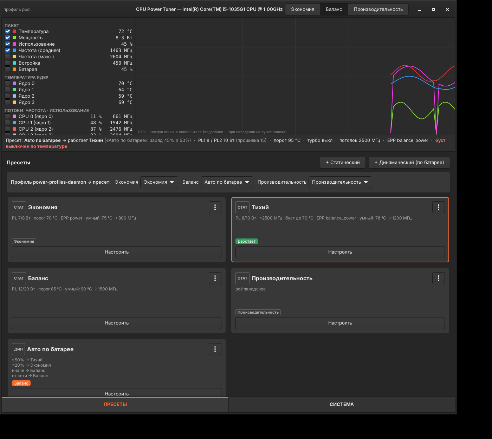
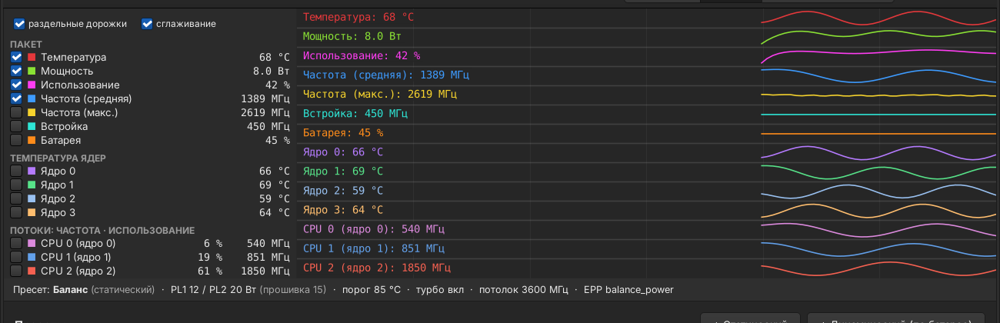
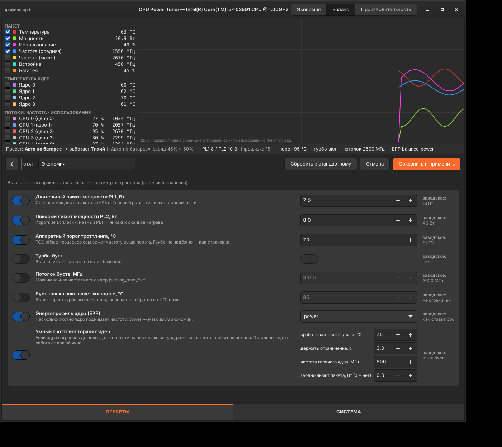
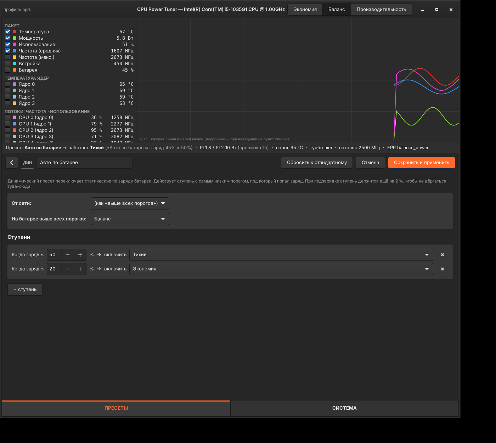

# cpu-power-tuner

Утилита в духе CoreCtrl для Intel-ноутбуков под Linux (Arch). Тёмный интерфейс: сверху сразу все
метрики (пакет, ядра, потоки — список с галочками + график), снизу пресеты и система.

Начато 13.11.2026. Проверено на HP Laptop 15s-fq1xxx (i5-1035G1, Ice Lake), Arch Linux, ядро 7.2.



График: **раздельные дорожки** (у каждой метрики своя полоса с автомасштабом и подписью) или
**наложение** всех линий в одном поле; плюс сглаживание. Переключается над списком метрик.



## Пресеты

- **Статический** — набор параметров (у каждого переключатель «управлять», выкл = заводское):
  PL1/PL2, аппаратный порог TCC, турбо, **потолок буста в МГц**, **буст только пока пакет холоднее N °C**,
  EPP, **умный троттлинг** (ядро нагрелось до порога → его потокам на N секунд режется частота,
  по желанию ещё и мощность всего пакета).
- **Умная парковка тяжёлых задач** (тоже в статическом пресете): когда ядро только подходит к порогу,
  самая тяжёлая задача на нём (поток, грузящий ядро ≥ N %) привязывается к самому холодному свободному ядру
  на N секунд, потом привязка снимается. Не трогает потоки ядра, realtime-задачи и задачи, которым вы сами
  ограничили ядра. Список задач читается только когда ядро выше порога.
- **Динамический** — переключает статические по заряду батареи: «≤50% → Тихий, ≤20% → Экономия,
  иначе Баланс, от сети — что-то своё». При подзарядке ступень держится ещё на 2% (гистерезис).
- Встроенные: Экономия, Тихий, Баланс, Производительность, Авто по батарее. Их можно менять,
  копировать и **сбрасывать к стандартным**; свои — создавать и удалять.
- Каждому профилю power-profiles-daemon назначается пресет (любой, в т.ч. динамический).
  Профиль переключается кнопками в заголовке окна.




## Установка и обновление

```bash
git clone https://github.com/k0kfjjfkdjf/cpu-power-tuner.git
cd cpu-power-tuner
sudo ./install.sh
```

Ставит зависимости (`python-gobject`, `python-cairo`, `gtk4`), копирует программу в `/opt/cpu-power-tuner`
(не запускается с сетевой папки), включает службу `cpu-power-tuner.service`, добавляет ярлык в меню.
Если включены `ppd-limits`, TLP, auto-cpufreq или thermald — предложит отключить (они спорят за те же настройки).

- GUI: `cpu-power-tuner` или «CPU Power Tuner» в меню
- консоль: `cpt status`, `cpt apply`, `cpt config`
- логи: `journalctl -u cpu-power-tuner -f`
- удаление: `sudo ./uninstall.sh` (`--purge` — вместе с конфигом)

Управлять из GUI может пользователь из группы `wheel` (меняется в конфиге, `socket_group`).

## Что настраивается в статическом пресете

| Параметр | Как работает | Выключен (не трогать) |
|---|---|---|
| PL1 / PL2, Вт | RAPL long_term / short_term | заводское значение |
| Аппаратный порог, °C | TCC offset = Tjmax − порог | заводское |
| Турбо | intel_pstate `no_turbo` | заводское |
| Потолок буста, МГц | `scaling_max_freq` всех потоков | максимум процессора |
| Буст до t пакета, °C | выше порога `no_turbo=1`, обратно на 5 °C ниже | не ограничен |
| EPP | `energy_performance_preference` | то, что ставит ppd |
| Умный троттлинг | горячее ядро → `scaling_max_freq` его потоков на N с (+ опц. лимит пакета) | выключен |
| Умная парковка | тяжёлый поток с тёплого ядра → `sched_setaffinity` на холодное на N с | выключена |

Встроенная графика только показывается, не настраивается.

## Как устроено

- `cpt/daemon.py` — служба от root. Цепочка: профиль ppd → назначенный пресет → (динамический) ступень по заряду →
  значения → + оверлей умного троттлинга. Цикл 0.5 с (профиль, батарея, температуры); раз в 5 с перепроверяет
  значения и возвращает их, если откатили (сон, ppd при смене батарея/сеть).
  При остановке возвращает заводские значения. Отвечает GUI через `/run/cpu-power-tuner/sock` (JSON по строкам).
- `cpt/hw.py` — чтение/запись sysfs и сбор статистики. `cpt/config.py` — конфиг и проверка значений.
- `cpt/gui.py` — GTK4. `cpt/client.py` — клиент и CLI.
- Конфиг: `/etc/cpu-power-tuner/config.toml` (можно править руками, потом `cpt apply`).
- Заводские значения: `/var/lib/cpu-power-tuner/factory.json` — снимаются при первом запуске службы.
  Чтобы снять заново: остановить службу, удалить файл, перезагрузиться, запустить.

## Тестирование без железа

```bash
CPT_ROOT=/tmp/fake CPT_CONFIG=/tmp/c/config.toml CPT_STATE=/tmp/s CPT_SOCKET=/tmp/sock/s python3 -m cpt.daemon
```
`CPT_ROOT` — корень поддельного sysfs.

## Структура

| Путь | Что это |
|---|---|
| `cpt/` | Программа |
| `data/` | systemd-юнит и .desktop |
| `install.sh`, `uninstall.sh` | Установка/удаление |
| `probe/probe.sh` | Разведка железа (только чтение) |
| `tests/run_test.sh` | Ручные тесты каждого рычага с замерами и откатом |
| `results/` | Выводы разведки и тестов, сводка `FINDINGS.md` |
| `docs/` | Скриншоты |

## Статус

- [x] Разведка (i5-1035G1, HP 15s-fq1xxx)
- [x] Тесты RAPL / TCC / no_turbo / EPP / iGPU — всё пишется и держится
- [x] Служба + GUI + CLI (проверено на поддельном sysfs)
- [x] v3: дорожки на графике, умная парковка задач
- [x] v2: тёмный интерфейс, пресеты-карточки, динамические пресеты по батарее, умный троттлинг, потолок буста
- [ ] Первый запуск на ноутбуке
