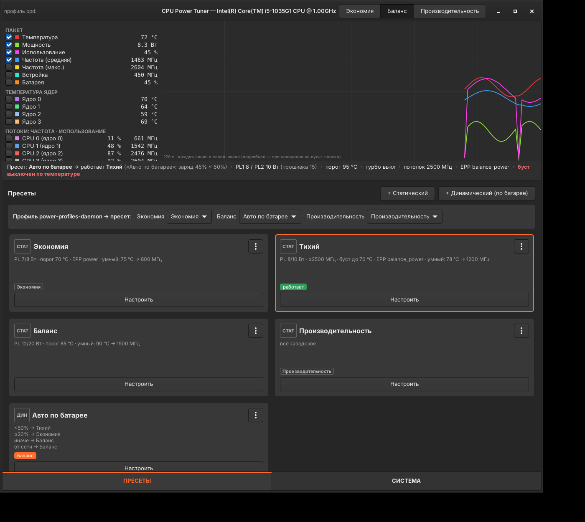
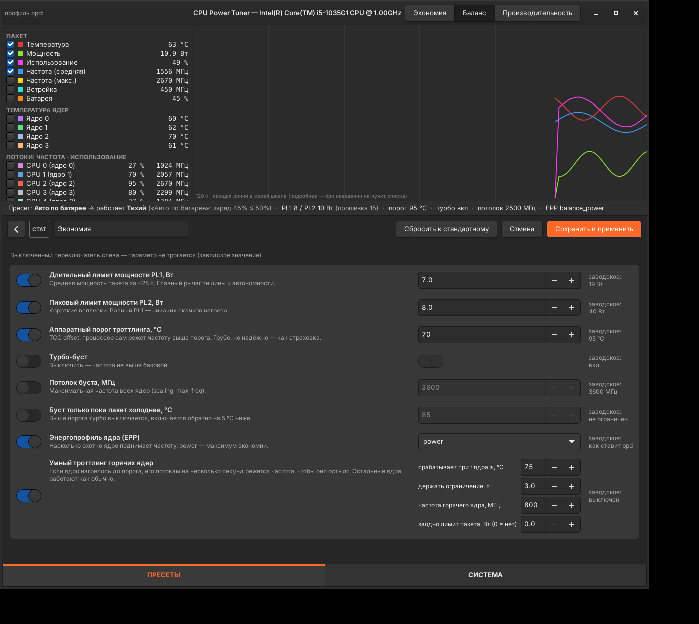
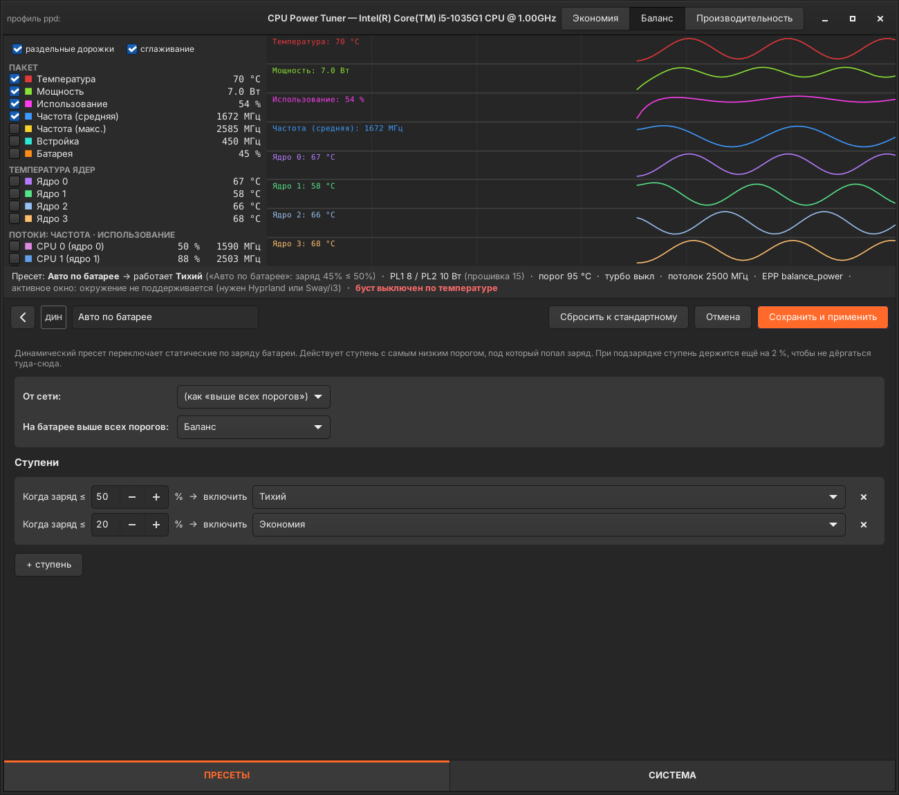
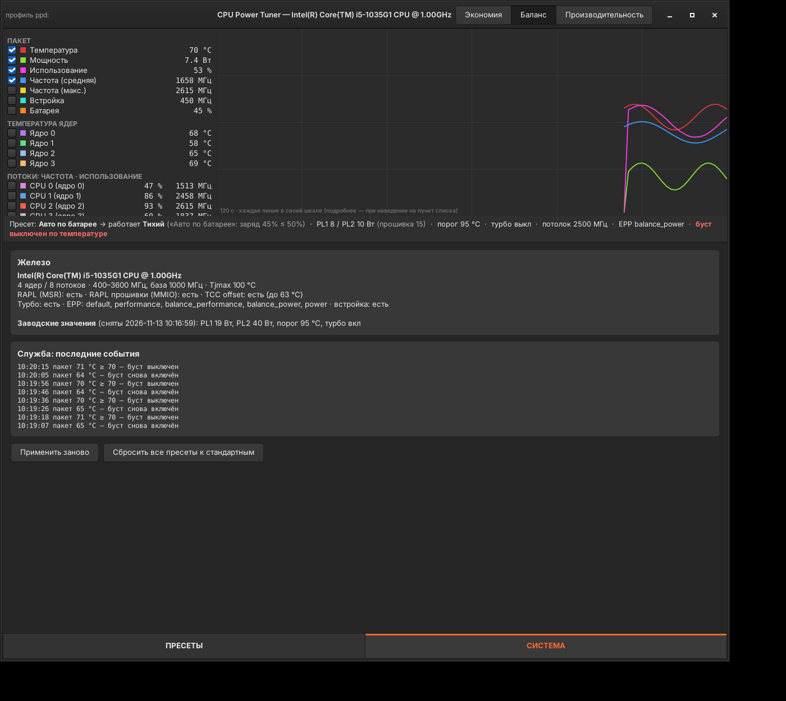

# cpu-power-tuner

[English](README.md) · **Русский**

**«Потато-мод» для ноутбука: дольше от батареи, тише и без лагов, когда одно ядро упирается в
тяжёлую задачу.** Утилита подсказывает планировщику Linux, куда сажать тяжёлые задачи, с учётом
температуры ядер — чего он сам на большинстве x86-ноутбуков не делает.

Управление питанием процессора для Linux-ноутбуков и ПК в духе CoreCtrl. Сразу показывает все ядра
и потоки (нагрузка, частота, температура, мощность пакета) и применяет **пресеты лимитов CPU**,
которые следуют за профилем питания: power-saver / balanced / performance из `power-profiles-daemon`
или профилем, выбранным вручную, если этой службы нет.

Кроме обычных лимитов умеет реагировать на нагрев отдельных ядер: **умный троттлинг** одного горячего
ядра, **парковка задач** (самая тяжёлая задача уезжает с нагревающегося ядра на более холодное) и
привязка **активного окна** к самым холодным ядрам, чтобы они могли бустить, пока остальные ядра
отдыхают на пониженном потолке («режим фокуса»); группы меняются ролями по мере нагрева.



---

## Содержание

- [Возможности](#возможности)
- [Совместимость](#совместимость)
- [Установка, обновление, удаление](#установка-обновление-удаление)
- [Быстрый старт](#быстрый-старт)
- [Как это устроено](#как-это-устроено)
- [Параметры статического пресета](#параметры-статического-пресета)
- [Умный троттлинг и отсрочка](#умный-троттлинг-и-отсрочка)
- [Парковка задач](#парковка-задач)
- [Режим фокуса: активное окно на холодных ядрах](#режим-фокуса-активное-окно-на-холодных-ядрах)
- [Динамические пресеты (ступени по батарее)](#динамические-пресеты-ступени-по-батарее)
- [Профили и power-profiles-daemon](#профили-и-power-profiles-daemon)
- [Файл конфигурации](#файл-конфигурации)
- [Командная строка](#командная-строка)
- [Безопасность и откат](#безопасность-и-откат)
- [Инструменты для тестов](#инструменты-для-тестов)
- [Замеры на реальном ноутбуке](#замеры-на-реальном-ноутбуке)
- [Если что-то не так](#если-что-то-не-так)
- [Структура проекта](#структура-проекта)

---

## Возможности

- **Монитор** — температура и мощность пакета, средняя и пиковая частота, нагрузка, частота встройки,
  батарея; температура каждого ядра; частота и нагрузка каждого потока. График: у каждой метрики своя
  дорожка с автомасштабом или все линии в одном поле; сглаживание по желанию.
- **Статические пресеты** — лимиты мощности PL1/PL2, аппаратный порог троттлинга (TCC), турбо,
  потолок частоты, «буст только пока холодно», энергопрофиль ядра (EPP), умный троттлинг, парковка
  задач, активное окно. У каждого параметра переключатель «управлять»: выключен — *не трогать,
  оставить заводское значение*.
- **Динамические пресеты** — переключают статические по заряду батареи («≤ 50 % → Тихий, ≤ 20 % →
  Экономия, от сети — свой»), с гистерезисом.
- **Встроенные пресеты** — Экономия, Тихий, Баланс, Производительность, Авто по батарее. Их можно
  менять, копировать и сбрасывать к стандартным; свои — создавать и удалять.
- **Привязка** — каждому профилю питания (power-saver / balanced / performance) назначается любой пресет.
- **Заводские значения** запоминаются при первом запуске и возвращаются при остановке службы.
- **Не даёт себя перебить** — значения перепроверяются каждые несколько секунд и возвращаются, если
  их откатила прошивка (после сна) или `power-profiles-daemon` (при переходе батарея/сеть).

| Статический пресет | Динамический пресет | Вкладка «Система» |
|---|---|---|
|  |  |  |

## Совместимость

Всё определяется на месте. Чего у машины нет — скрыто в интерфейсе и никогда не записывается.

| Функция | Где работает | Интерфейс Linux |
|---|---|---|
| Лимиты мощности PL1/PL2 | Intel (Sandy Bridge и новее) | `powercap/intel-rapl:0` |
| Показ лимита прошивки | Intel с `processor_thermal` | `powercap/intel-rapl-mmio:0` (только чтение) |
| Мощность пакета | Intel, AMD Zen | `intel-rapl:0/energy_uj` |
| Аппаратный порог (TCC) | Intel (Skylake и новее, если BIOS не заблокировал) | охлаждающее устройство `intel_tcc_cooling` |
| Турбо вкл/выкл | Intel `intel_pstate`; AMD и другие через `cpufreq/boost` | `no_turbo` или `boost` |
| Потолок частоты | любой драйвер `cpufreq`, включая ARM; у гибридных P/E-ядер учитывается свой максимум | `scaling_max_freq` каждого потока |
| EPP | `intel_pstate`, `amd-pstate` (режим active) | `energy_performance_preference` |
| Температура по ядрам | Intel `coretemp` (по ядрам); AMD `k10temp`/`zenpower` (по CCD, приближённо) | hwmon |
| Только температура пакета | всё остальное (ARM-SoC и т.п.) — функции «по ядрам» тогда выключены | термозона |
| Многопроцессорные, гибридные | ядра различаются по `package_id` + `core_id`; максимум частоты у каждого потока свой | topology |
| Частота встройки (только показ) | Intel `i915`, Intel `xe`, AMD `amdgpu` | DRM sysfs |
| Активное окно | Hyprland, Sway, i3 | IPC-сокеты композитора |
| Профили питания | `power-profiles-daemon`; без него — ручное переключение | `state.ini` |
| Дистрибутивы (установщик) | Arch, Debian/Ubuntu, Fedora, openSUSE; остальные вручную | — |

Нужно: Linux с systemd, Python ≥ 3.11, PyGObject + pycairo, GTK 4.

**Проверено на железе:** HP 15s-fq1xxx, Intel Core i5-1035G1 (Ice Lake), Arch Linux, ядро 7.2, Hyprland.
Пути для AMD, ARM и Sway проверены только на имитации sysfs и IPC — отчёты приветствуются.

## Установка, обновление, удаление

```bash
git clone https://github.com/k0kfjjfkdjf/cpu-power-tuner.git
cd cpu-power-tuner
sudo ./install.sh        # эта же команда обновляет уже установленную версию
```

Установщик:
- ставит зависимости через `pacman` / `apt` / `dnf` / `zypper`;
- предлагает отключить службы, которые спорят за те же настройки (TLP, auto-cpufreq, thermald);
- копирует программу в `/opt/cpu-power-tuner`, добавляет `cpu-power-tuner` (окно) и `cpt` (консоль)
  в `/usr/local/bin` и ярлык в меню;
- включает и (пере)запускает `cpu-power-tuner.service`.

Управлять службой из окна могут только участники группы `wheel` (или `sudo`/`admin` — какая найдётся).
Добавить себя: `sudo usermod -aG wheel $USER` и перелогиниться.

Удаление: `sudo ./uninstall.sh` (конфиг остаётся) или `sudo ./uninstall.sh --purge`.

> **Первый запуск:** заводские значения снимаются с *текущих* настроек. Если вы перед установкой
> меняли лимиты вручную — сначала перезагрузитесь.

## Быстрый старт

1. Откройте **CPU Power Tuner** из меню приложений (или `cpu-power-tuner`).
2. Верхняя половина — метрики. Отметьте галочками, что показывать на графике; режим «дорожки /
   наложение» и сглаживание — над списком.
3. Вкладка **Пресеты** (внизу) — строка «Профиль power-profiles-daemon → пресет» решает, какой пресет
   работает в каждом профиле. Работающий пресет обведён оранжевым и помечен «работает».
4. «Настроить» на карточке → поменять значения → **Сохранить и применить**. Действует сразу.
5. Профиль переключается кнопками в заголовке окна.

## Как это устроено

```
 профиль питания ──► назначенный пресет ──► (динамический?) ступень по батарее ──► статический пресет
 (ppd или вручную)                                                                       │
                                                                                         ▼
 температуры ──► оверлей умного троттлинга / буста по температуре ──► целевые значения ──► sysfs
      │                                                                                  ▲
      └──► парковка задач, активное окно ──► привязка к ядрам (sched_setaffinity)
```

- **`cpt/daemon.py`** — служба от root. Каждые **0,5 с** смотрит профиль, батарею, температуры
  (только если включена функция «по ядрам») и реагирует. Каждые **5 с** перечитывает все управляемые
  значения и возвращает то, что откатили. С окном общается через unix-сокет
  (`/run/cpu-power-tuner/sock`, JSON построчно).
- **`cpt/hw.py`** — определяет железо, читает и пишет sysfs. Если значение уже стоит, запись
  пропускается; если ядро округлило или зажало значение (у RAPL шаг 0,125 Вт), запоминается
  результат, чтобы не переписывать его бесконечно.
- **`cpt/park.py`**, **`cpt/focus.py`** — функции с привязкой к ядрам.
- **`cpt/gui.py`** — окно на GTK 4, работает от вашего пользователя и к железу напрямую не обращается.
- **`cpt/config.py`** — пресеты, проверка значений, чтение и запись TOML.

## Параметры статического пресета

| Параметр | Что делает | Ручка Linux | Когда выключен |
|---|---|---|---|
| **PL1**, Вт | Длительный лимит мощности пакета (среднее за ≈28 с). Главный рычаг тишины и автономности. | `intel-rapl:0/constraint_0_power_limit_uw` | заводское |
| **PL2**, Вт | Короткий (пиковый) лимит. Равный PL1 — никаких скачков нагрева. | `constraint_1_power_limit_uw` | заводское |
| **Аппаратный порог**, °C | Процессор сам режет частоту выше порога (Tjmax − TCC offset). Грубо — как страховка. | `intel_tcc_cooling` `cur_state` | заводское |
| **Турбо** | Выкл — частота не выше базовой. | `intel_pstate/no_turbo` или `cpufreq/boost` | заводское |
| **Потолок буста**, МГц | Максимальная частота всех потоков (у гибридных — не выше собственного максимума потока). | `scaling_max_freq` | максимум железа |
| **Буст только пока пакет < N °C** | Выше N турбо выключается, обратно — на 5 °C ниже. | как «Турбо» | не ограничен |
| **EPP** | Насколько охотно ядра поднимают частоту. `power` — максимум экономии. | `energy_performance_preference` | что ставит `power-profiles-daemon` |
| **Умный троттлинг** | См. ниже. | `scaling_max_freq` потоков горячего ядра | выкл |
| **Парковка задач** | См. ниже. | `sched_setaffinity` | выкл |
| **Режим фокуса** | См. ниже. | `sched_setaffinity`, `setpriority`, `scaling_max_freq` и EPP по ядрам | выкл |

Совет по реальным замерам: лимит мощности намного эффективнее порога TCC. Порог 50 °C дал 231 МГц
при 7 Вт (пропуск тактов), а лимит 7 Вт — 845 МГц.

## Умный троттлинг и отсрочка

Поля: **порог °C**, **держать с**, **частота горячего ядра МГц**, **заодно лимит пакета Вт** (0 — нет),
**отсрочка с**.

Когда ядро доходит до порога, потокам *только этого ядра* на *держать* секунд снижается
`scaling_max_freq` до выбранной частоты; остальные ядра работают как обычно. По желанию заодно
снижается лимит всего пакета (PL1/PL2).

**Отсрочка** (работает при включённой парковке): частота режется не сразу — сначала ядру даётся
*отсрочка* в секундах, за которые парковка срочно его разгружает (по задаче каждые 0,5 с, даже ниже
собственного порога парковки). Если ядро остыло на 2 °C ниже порога — троттлинг отменяется («остыло
без троттлинга»). Иначе частота режется как обычно. Заодно это гасит шум датчика, когда ядро
колеблется прямо на пороге.

## Парковка задач

Поля: **порог °C**, **держать с** (0 — пока новое ядро не нагреется), **минимальная загрузка задачи %**.

1. Пока все ядра ниже порога, ничего не происходит — список процессов даже не читается.
2. Ядро дошло до порога — дешёвая проверка по `/proc/stat`: загружено ли оно хотя бы на
   *минимальную загрузку*. Только тогда читаются все потоки (`/proc/*/task/*/stat`) дважды с интервалом
   0,5 с, чтобы измерить загрузку каждого.
3. **Куда везти**, по порядку:
   - *основное правило* — ядро ниже порога **и** хотя бы на 3 °C холоднее горячего;
   - *резерв* — самое холодное из доступных ядер, хоть на 1 °C холоднее («берём что есть»).
     На ядро той же температуры не везём — иначе пинг-понг из-за шума датчика.

   Не годятся: ядра под умным троттлингом или в отсрочке, ядра активного окна, ядра, чьи потоки уже
   заняты больше чем наполовину.
4. Самый тяжёлый поток горячего ядра привязывается к потокам ядра-приёмника. Не чаще одной задачи
   в 2 с (в отсрочке — каждые 0,5 с).
5. **Отпускание** — через *держать* секунд; при 0 задача живёт на новом ядре, пока оно не дойдёт до
   порога, а тогда переезжает на ядро холоднее (не чаще раза в 5 с). Если её ядро под троттлингом, а
   холоднее ничего нет, задача отпускается.

Никогда не паркуются: потоки ядра Linux, PID 1, realtime-задачи, задачи, которым вы сами запретили
ядро-приёмник, процессы активного окна и **«запускатели»** (композиторы, терминалы, оболочки,
лаунчеры, панели: Hyprland, sway, kitty, fish, waybar, …). Привязка к ядрам наследуется детьми:
припаркуй композитор — и все программы, запущенные после, окажутся на одном ядре. Если
припаркованная задача всё же запустила детей, они возвращаются вместе с ней.

Все привязки записываются в журнал `/var/lib/cpu-power-tuner/pins.json`; после сбоя или перезапуска
служба возвращает ровно то, что привязала сама (сверяя время старта каждого потока и boot id).

## Режим фокуса: активное окно на холодных ядрах

Ядра делятся на **рабочую группу** (N самых холодных) и **отдыхающую** (остальные).

| Поле | Что значит |
|---|---|
| сколько самых холодных ядер отдать | размер рабочей группы (N) |
| пересматривать выбор ядер раз в, с | как часто пересматривается выбор |
| переезжать, если другие холоднее на, °C | порог ротации по нагреву |
| ротация групп по таймеру, с | менять группы каждые T секунд независимо от нагрева (0 — только по нагреву) |
| приоритет окна, nice | повышение приоритета активного окна, например −5 (0 — не трогать) |
| приоритет композитора, nice | повышение приоритета Hyprland/Sway/… (0 — не трогать) |
| отдыхающим ядрам минус к потолку, МГц | отдыхающая группа работает на столько ниже потолка пресета (0 — нет) |
| EPP power отдыхающим ядрам | отдыхающие ядра неохотно поднимают частоту (1 — да) |

Как работает:
1. Раз в секунду служба спрашивает у композитора, какое окно в фокусе (Hyprland `j/activewindow`;
   Sway/i3 `GET_TREE`), и берёт его процесс со всеми потомками (браузеры и Electron-приложения
   работают в дочерних процессах).
2. Это дерево привязывается к рабочей группе и получает повышенный приоритет (`nice`): когда ядер не
   хватает, планировщик сначала обслуживает ваше окно.
3. Отдыхающей группе — потолок частоты ниже и EPP `power`: фоновые задачи на этих ядрах работают
   медленнее и холоднее. Частота в Linux задаётся для ядра, а не для процесса, поэтому разделение
   мягкое: фон может попасть и на рабочее ядро, но там уступает окну по приоритету.
4. **Ротация** — когда рабочая группа стала горячее отдыхающей на заданный запас, когда рабочее
   ядро попало под троттлинг или каждые T секунд, группы меняются ролями: окно переезжает, а
   пониженный потолок и EPP переходят на новую отдыхающую группу.
5. Композитор **к ядрам не привязывается** (привязку унаследовали бы все программы, которые он
   запускает) — только повышение приоритета, если включено.
6. Сменили окно — прошлое приложение получает обратно исходные привязку и приоритет, вместе с
   детьми, которых оно успело запустить.

Размер рабочей группы — потолок для приложения в фокусе; тяжёлой многопоточной работе дайте больше ядер.

## Динамические пресеты (ступени по батарее)

- **Ступени**: «когда заряд ≤ X % → статический пресет P». Действует ступень с самым низким
  подходящим порогом.
- **Выше всех порогов** — пресет на батарее, когда ни одна ступень не подошла.
- **От сети** — отдельный пресет или «как выше всех порогов».
- **Гистерезис** — при подзарядке ступень держится, пока заряд не станет на 2 % выше её порога
  (`general.hysteresis_pct`).

## Профили и power-profiles-daemon

С `power-profiles-daemon` служба следит за его текущим профилем (`/var/lib/power-profiles-daemon/state.ini`),
а кнопки в заголовке вызывают `powerprofilesctl set`. `power-profiles-daemon` сам ставит EPP; если
пресет управляет EPP, служба перебивает значение и возвращает своё, когда демон снова его меняет
(например, при переходе батарея/сеть).

Без `power-profiles-daemon` в заголовке написано «профиль (вручную, без ppd)»; кнопки (или
`cpt profile <имя>`) переключают профиль внутри службы, он запоминается между перезапусками.

## Файл конфигурации

`/etc/cpu-power-tuner/config.toml` — пишет окно, можно править руками; применить — `cpt apply`.

```toml
[general]
socket_group = "wheel"      # кто может управлять службой (иначе sudo/admin)
verify_interval = 5         # секунд между перепроверками
restore_on_stop = true      # при остановке службы вернуть заводские значения
hysteresis_pct = 2          # динамические пресеты

[bindings]                  # профиль питания -> id пресета
power-saver = "eco"
balanced = "auto_battery"
performance = "performance"

[presets.eco]
name = "Экономия"
type = "static"
builtin = "eco"             # встроенные можно сбросить к стандартным
pl1_w = { enabled = true, value = 7.0 }
pl2_w = { enabled = true, value = 8.0 }
temp_limit_c = { enabled = true, value = 70 }
turbo = { enabled = false, value = true }
max_freq_mhz = { enabled = false, value = 3600 }
boost_temp_c = { enabled = false, value = 85 }
epp = { enabled = true, value = "power" }
smart = { enabled = true, value = { trigger_c = 75, hold_s = 3.0, core_mhz = 800, pkg_w = 0.0, grace_s = 2.0 } }
park = { enabled = true, value = { trigger_c = 70, hold_s = 0.0, min_load_pct = 50 } }
focus = { enabled = false, value = { cores = 2, recheck_s = 5.0, swap_margin_c = 4, rotate_s = 0.0, nice = -5, comp_nice = 0, bg_drop_mhz = 200, bg_epp_power = 1 } }

[presets.auto_battery]
name = "Авто по батарее"
type = "dynamic"
on_ac = ""                  # "" — как default
default = "balanced"
steps = [{ below = 50, preset = "quiet" }, { below = 20, preset = "eco" }]
```

Другие файлы: `/var/lib/cpu-power-tuner/factory.json` (заводские значения), `pins.json` (журнал
привязок), `profile` (ручной профиль, когда нет ppd).

## Командная строка

| Команда | Что делает |
|---|---|
| `cpt status` | профиль → пресет → работающий пресет, лимиты, все потоки |
| `cpt apply` | перечитать `config.toml` и применить сейчас |
| `cpt config` | показать действующий конфиг |
| `cpt profile <power-saver\|balanced\|performance>` | переключить профиль (только без power-profiles-daemon) |
| `cpt unpin` | вернуть привязки к ядрам, оставшиеся от прошлого запуска; на процессорах с SMT ещё и сбросить «привязки к целым ядрам», которые служба не ведёт |
| `journalctl -u cpu-power-tuner -f` | живой журнал: смена профиля, парковка, троттлинг |

## Безопасность и откат

- Пишутся только документированные интерфейсы ядра (sysfs, powercap, охлаждающие устройства,
  `sched_setaffinity`). Никаких записей в MSR и андервольта.
- Каждое значение проверяется и ограничивается (например, PL2 ≥ PL1, частоты в пределах железа).
- Остановка службы (`systemctl stop cpu-power-tuner`, удаление) возвращает заводские значения и
  снимает все поставленные привязки.
- Перезагрузка всегда возвращает железо к значениям прошивки; потом служба снова применяет ваш пресет.

## Инструменты для тестов

| Инструмент | Зачем |
|---|---|
| `sudo ./probe/probe.sh` | разведка машины, только чтение → `results/probe-<host>-<дата>.txt` |
| `sudo ./tests/run_test.sh rapl 7` (а также `tcc`, `turbo`, `epp`, `gpu`, `all`) | применить один рычаг под полной нагрузкой, замерить, проверить, что держится 30 с, вернуть |
| `python3 tests/duck.py` | «утка» `cpt-duck`, грузит одно ядро; журнал, где она работает, смены привязки, температуры и события службы → `results/duck-*.log/.tsv` |

Для проверки парковки запускайте утку вне дерева процессов терминала, иначе её заберёт «активное
окно»: `systemd-run --user --pty python3 "$PWD/tests/duck.py" --load 90 --time 180`.

## Замеры на реальном ноутбуке

i5-1035G1, все 8 потоков на 100 % 15 с, от сети, ppd = balanced (`results/FINDINGS.md`):

| Настройка | Мощность пакета | Средняя частота | Макс. t |
|---|---|---|---|
| без ограничений | 23,8 Вт | 2456 МГц | 96 °C |
| PL1 = PL2 = 7 Вт | 7,7 Вт | 845 МГц | 72 °C |
| PL1 = PL2 = 8 Вт | 8,6 Вт | 1078 МГц | 71 °C |
| турбо выкл | 8,2 Вт | 999 МГц | 71 °C |
| EPP = power | 9,6 Вт | 1299 МГц | 74 °C |

Тест парковки с уткой (один прогон, лимит 5 Вт): задачу на 90 % с ядра 0 (56 °C) перенесло на ядро 3
(52 °C), и она осталась там до конца прогона, ещё 2,7 минуты. Ядро 0 держалось на 52–55 °C (в прошлом
прогоне без парковки — 56–58 °C), умному троттлингу ни разу не пришлось резать частоту.

## Если что-то не так

| Симптом | Что сделать |
|---|---|
| В окне «Нет связи со службой» | `systemctl status cpu-power-tuner`; проверьте, что вы в группе `wheel`/`sudo` и перелогинились |
| Значение, выставленное в окне, откатывается | после обновления открыто старое окно — закройте и откройте заново |
| `sudo ./install.sh: команда не найдена` | файл потерял право на запуск: `sudo bash ./install.sh` |
| Программы работают только на части ядер | `cpt unpin`; проверить — `taskset -p <pid>` (fish: `taskset -p $fish_pid`) |
| В окне нет умного троттлинга и парковки | на этой машине нет датчиков температуры по ядрам (см. вкладку «Система») |
| Активное окно: «окружение не поддерживается» | поддерживаются только Hyprland, Sway и i3 |
| Не записываются PL1/PL2 | лимиты заблокированы BIOS — используйте потолок частоты, турбо и EPP |

## Структура проекта

| Путь | Что это |
|---|---|
| `cpt/` | программа (служба, окно, консоль, слой железа) |
| `data/` | systemd-юнит, ярлык |
| `install.sh`, `uninstall.sh` | установка / обновление / удаление |
| `probe/probe.sh` | разведка железа |
| `tests/run_test.sh`, `tests/duck.py` | ручные тесты |
| `results/` | результаты разведки и тестов на ноутбуке автора, сводка в `FINDINGS.md` |
| `docs/` | скриншоты |

Лицензия пока не выбрана — до появления файла лицензии все права у автора.
